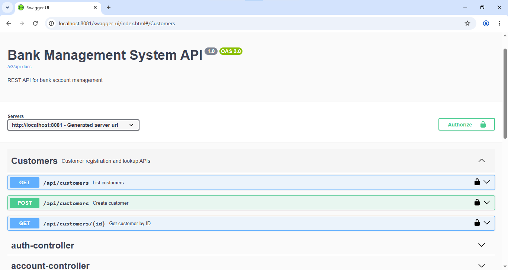
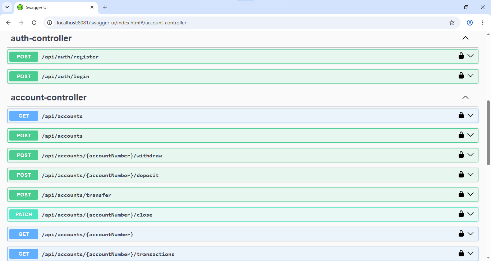
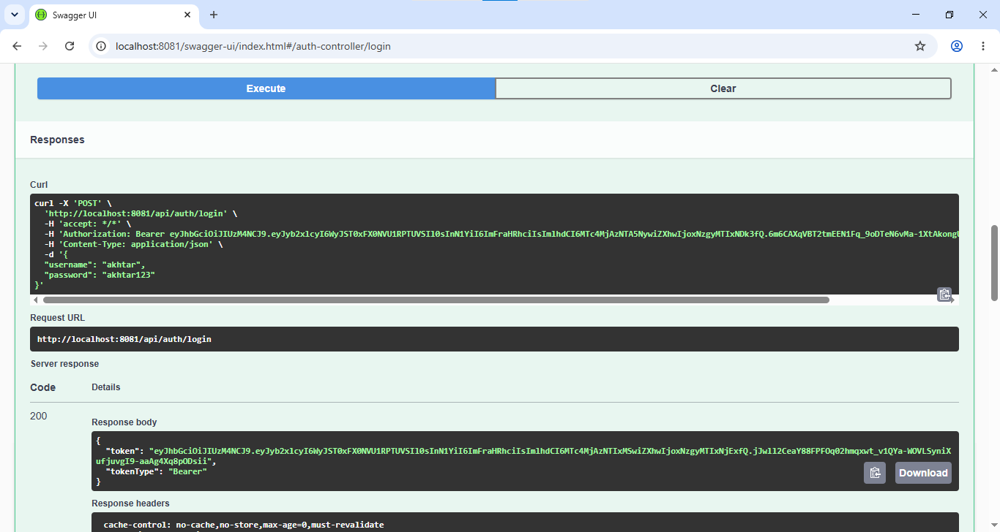
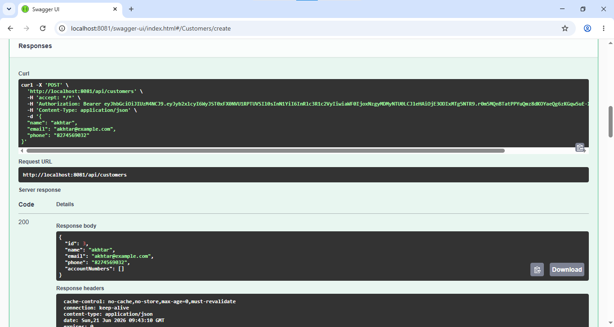
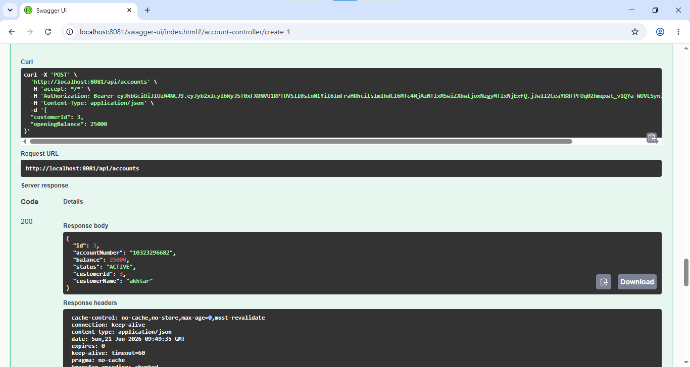
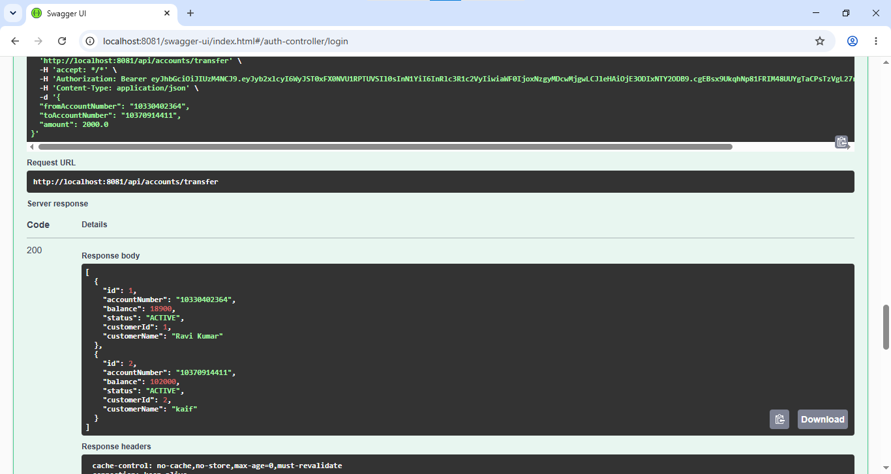
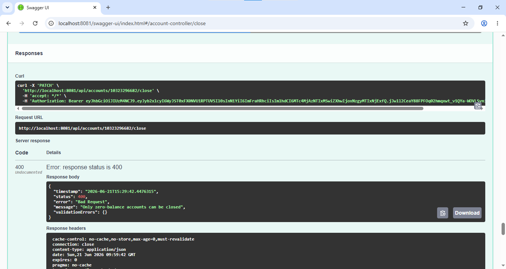
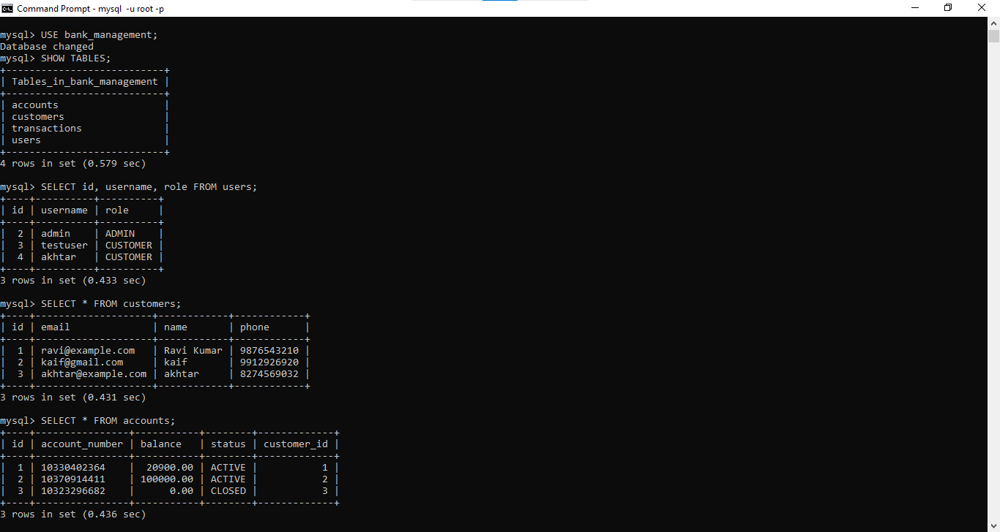

# Bank Management System

A secure Spring Boot 3 REST API for managing customers, bank accounts, deposits, withdrawals, transfers, and transaction history. This project is designed as a Java Backend Developer portfolio project and demonstrates layered architecture, JWT security, relational persistence, validation, exception handling, API documentation, and automated testing.

## Project Overview

The Bank Management System exposes REST APIs for common banking workflows:

- Register and authenticate users with JWT.
- Create and retrieve customer records.
- Create, retrieve, and close bank accounts.
- Deposit, withdraw, and transfer funds.
- Record and retrieve account transaction history.
- Validate incoming requests and return consistent error responses.
- Explore and test APIs through Swagger/OpenAPI documentation.

The codebase follows a conventional Spring Boot service-oriented structure with controllers, DTOs, services, repositories, entities, security components, and exception handling separated by responsibility.

## Major Features

- **Spring Boot 3** backend using Java 17 and Maven.
- **MySQL** relational database integration.
- **Spring Data JPA / Hibernate** for ORM and repository-based persistence.
- **JWT Authentication & Authorization** with Spring Security and stateless request filtering.
- **Customer CRUD** for customer registration and lookup.
- **Account CRUD** for account creation, lookup, listing, and closure.
- **Deposit / Withdraw / Transfer Operations** with transactional balance updates.
- **Transaction History** with transaction type, amount, timestamp, description, and balance-after tracking.
- **Swagger/OpenAPI Documentation** using Springdoc OpenAPI.
- **JUnit + Mockito Testing** for test dependency verification and exception handling behavior.
- **Bean Validation** with Jakarta Validation annotations on request DTOs.
- **Global Exception Handling** with structured API error responses.

## Tech Stack

| Category | Technology |
| --- | --- |
| Language | Java 17 |
| Framework | Spring Boot 3.3.5 |
| API | Spring Web REST |
| Security | Spring Security, JWT, BCrypt |
| Persistence | Spring Data JPA, Hibernate |
| Database | MySQL |
| Validation | Jakarta Bean Validation |
| Documentation | Springdoc OpenAPI / Swagger UI |
| Testing | JUnit Jupiter, Mockito, Spring Test |
| Build Tool | Maven |

## Architecture Overview

```text
Client / Swagger UI
        |
        v
REST Controllers
        |
        v
DTO Validation + Global Exception Handling
        |
        v
Service Layer
        |
        v
Spring Data JPA Repositories
        |
        v
MySQL Database
```

Security is handled by Spring Security before requests reach protected controllers. Public authentication and Swagger endpoints are allowed without a token. All other API routes require a valid `Authorization: Bearer <token>` header. JWT generation and validation are handled by the custom JWT service and authentication filter.

## Project Structure

```text
.
|-- pom.xml
|-- README.md
|-- .env.example
|-- .gitignore
|-- screenshots/
|   |-- account-create.png.png
|   |-- Customer-create.png.png
|   |-- database.png.png
|   |-- login.png.png
|   |-- Swagger-home.png.png
|   |-- Swagger-home1.png.png
|   |-- transfer.png
|   `-- validation.png.png
`-- src/
    |-- main/
    |   |-- java/com/example/bank/
    |   |   |-- BankManagementApplication.java
    |   |   |-- config/        # Security, OpenAPI, and optional startup data configuration
    |   |   |-- controller/    # REST API controllers
    |   |   |-- dto/           # Request and response DTOs
    |   |   |-- exception/     # Custom exceptions and global error handler
    |   |   |-- model/         # JPA entities and enums
    |   |   |-- repository/    # Spring Data JPA repositories
    |   |   |-- security/      # JWT filter, token service, and user details service
    |   |   `-- service/       # Business logic
    |   `-- resources/
    |       `-- application.properties
    `-- test/
        `-- java/com/example/bank/
            |-- TestingDependenciesTest.java
            `-- exception/GlobalExceptionHandlerTest.java
```

## Database Design

The application uses Hibernate entities mapped to MySQL tables.

### `users`

Stores application users used by Spring Security.

| Column | Description |
| --- | --- |
| `id` | Primary key |
| `username` | Unique login username |
| `password` | BCrypt-hashed password |
| `role` | User role, such as `ADMIN` or `CUSTOMER` |

### `customers`

Stores bank customer profile information.

| Column | Description |
| --- | --- |
| `id` | Primary key |
| `name` | Customer name |
| `email` | Unique customer email |
| `phone` | 10-digit phone number |

### `accounts`

Stores bank account details.

| Column | Description |
| --- | --- |
| `id` | Primary key |
| `account_number` | Unique generated account number |
| `balance` | Current account balance |
| `status` | Account status, such as `ACTIVE` or `CLOSED` |
| `customer_id` | Foreign key to `customers` |

### `transactions`

Stores account transaction history.

| Column | Description |
| --- | --- |
| `id` | Primary key |
| `type` | Transaction type |
| `amount` | Transaction amount |
| `balance_after` | Balance after transaction completion |
| `created_at` | Transaction timestamp |
| `description` | Human-readable transaction note |
| `account_id` | Foreign key to `accounts` |

## API Endpoints

### Authentication

| Method | Endpoint | Auth Required | Description |
| --- | --- | --- | --- |
| `POST` | `/api/auth/register` | No | Register a new user |
| `POST` | `/api/auth/login` | No | Authenticate and receive a JWT |

### Customers

| Method | Endpoint | Auth Required | Description |
| --- | --- | --- | --- |
| `POST` | `/api/customers` | Yes | Create a customer |
| `GET` | `/api/customers` | Yes | List all customers |
| `GET` | `/api/customers/{id}` | Yes | Get a customer by ID |

### Accounts

| Method | Endpoint | Auth Required | Description |
| --- | --- | --- | --- |
| `POST` | `/api/accounts` | Yes | Create an account for a customer |
| `GET` | `/api/accounts` | Yes | List all accounts |
| `GET` | `/api/accounts/{accountNumber}` | Yes | Get account details by account number |
| `POST` | `/api/accounts/{accountNumber}/deposit` | Yes | Deposit money into an account |
| `POST` | `/api/accounts/{accountNumber}/withdraw` | Yes | Withdraw money from an account |
| `POST` | `/api/accounts/transfer` | Yes | Transfer money between accounts |
| `GET` | `/api/accounts/{accountNumber}/transactions` | Yes | Get transaction history for an account |
| `PATCH` | `/api/accounts/{accountNumber}/close` | Yes | Close a zero-balance account |

### Swagger / OpenAPI

| Method | Endpoint | Auth Required | Description |
| --- | --- | --- | --- |
| `GET` | `/swagger-ui/index.html` | No | Swagger UI |
| `GET` | `/v3/api-docs` | No | OpenAPI JSON |

## Authentication Flow

1. A user registers through `POST /api/auth/register` or an admin account is optionally bootstrapped from environment variables.
2. The user logs in through `POST /api/auth/login`.
3. The API returns a JWT access token.
4. The client sends the token with protected requests:

```http
Authorization: Bearer <token>
```

5. `JwtAuthenticationFilter` validates the token and loads user details.
6. Spring Security allows the request if the token is valid.

## Screenshots

### Swagger API Home



Interactive Swagger UI showing grouped REST endpoints for the banking API.

### Swagger Endpoint Details



Expanded Swagger documentation for testing secured API operations.

### User Login



JWT login request flow used to authenticate API clients.

### Customer Creation



Customer creation endpoint with validated customer profile details.

### Account Creation



Account creation flow linked to an existing customer record.

### Fund Transfer



Account-to-account transfer operation with request and response details.

### Validation Error Handling



Consistent validation response returned by the global exception handler.

### Database Records



Persisted banking data stored in the relational database.

## Setup & Installation

### Prerequisites

- Java 17 or later
- Maven 3.9 or later
- MySQL 8 or later

### 1. Clone the Repository

```bash
git clone https://github.com/<your-username>/bank-management-system.git
cd bank-management-system
```

### 2. Create the MySQL Database

```sql
CREATE DATABASE bank_management;
```

The application also includes `createDatabaseIfNotExist=true` in the JDBC URL for local development.

### 3. Configure Environment Variables

Use `.env.example` as a reference. Set these values in your terminal, IDE run configuration, or deployment environment:

```bash
DB_USERNAME=root
DB_PASSWORD=your_mysql_password
JWT_SECRET=replace-with-a-long-random-secret-at-least-32-characters
JWT_EXPIRATION_MS=86400000
SERVER_PORT=8081
APP_ADMIN_USERNAME=admin
APP_ADMIN_PASSWORD=change_this_password
```

On Windows PowerShell:

```powershell
$env:DB_USERNAME="root"
$env:DB_PASSWORD="your_mysql_password"
$env:JWT_SECRET="replace-with-a-long-random-secret-at-least-32-characters"
$env:APP_ADMIN_USERNAME="admin"
$env:APP_ADMIN_PASSWORD="change_this_password"
```

`APP_ADMIN_USERNAME` and `APP_ADMIN_PASSWORD` are optional. If either value is blank, the application will not create a startup admin user.

### 4. Run the Application

```bash
mvn spring-boot:run
```

The API runs at:

```text
http://localhost:8081
```

Swagger UI is available at:

```text
http://localhost:8081/swagger-ui/index.html
```

## Example Requests

### Register

```http
POST /api/auth/register
Content-Type: application/json

{
  "username": "customer1",
  "password": "password123"
}
```

### Login

```http
POST /api/auth/login
Content-Type: application/json

{
  "username": "customer1",
  "password": "password123"
}
```

### Create Customer

```http
POST /api/customers
Authorization: Bearer <token>
Content-Type: application/json

{
  "name": "Ravi Kumar",
  "email": "ravi@example.com",
  "phone": "9876543210"
}
```

### Create Account

```http
POST /api/accounts
Authorization: Bearer <token>
Content-Type: application/json

{
  "customerId": 1,
  "openingBalance": 1000.00
}
```

### Deposit

```http
POST /api/accounts/10123456789/deposit
Authorization: Bearer <token>
Content-Type: application/json

{
  "amount": 500.00
}
```

### Withdraw

```http
POST /api/accounts/10123456789/withdraw
Authorization: Bearer <token>
Content-Type: application/json

{
  "amount": 200.00
}
```

### Transfer

```http
POST /api/accounts/transfer
Authorization: Bearer <token>
Content-Type: application/json

{
  "fromAccountNumber": "10123456789",
  "toAccountNumber": "10987654321",
  "amount": 250.00
}
```

## Testing Instructions

Run the automated test suite with Maven:

```bash
mvn test
```

Current tests verify that:

- JUnit Jupiter and Mockito are available in the project.
- Validation failures are handled by the global exception handler with a structured response.

Recommended next testing additions:

- Service-layer tests for deposit, withdrawal, transfer, and account closure rules.
- Repository integration tests with a test database profile.
- Controller tests for secured endpoints and JWT authentication behavior.

## Security Notes

- Real database passwords and JWT secrets are not committed to this repository.
- Passwords are stored with BCrypt hashing.
- JWT secret values should be long, random, and provided through environment variables.
- `.env` and local property override files are ignored by Git.
- The optional startup admin user must be configured through environment variables.

## Future Enhancements

- Add role-specific authorization rules for admin and customer APIs.
- Add pagination and filtering for customers, accounts, and transactions.
- Add Docker Compose for MySQL and local development.
- Add database migrations with Flyway or Liquibase.
- Add integration tests using Testcontainers.
- Add CI workflow for build and test verification.
- Add refresh-token support and token revocation.
- Add audit logging for financial operations.


